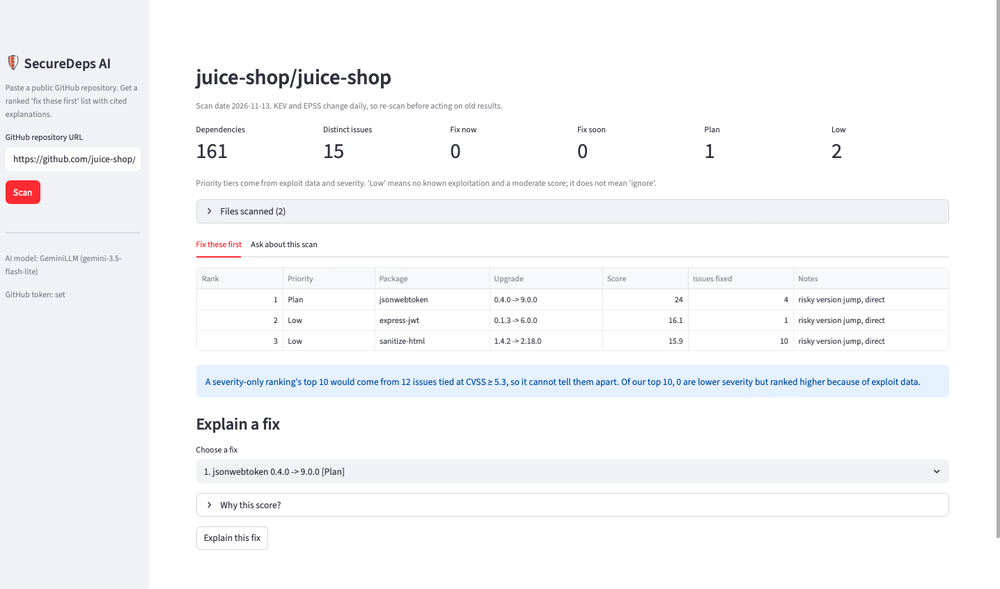
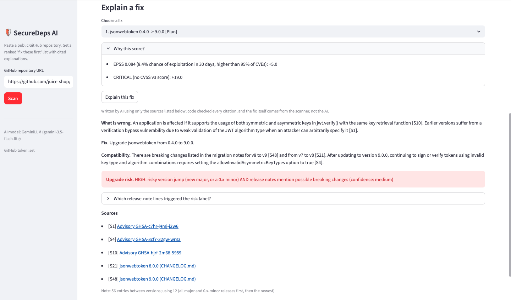
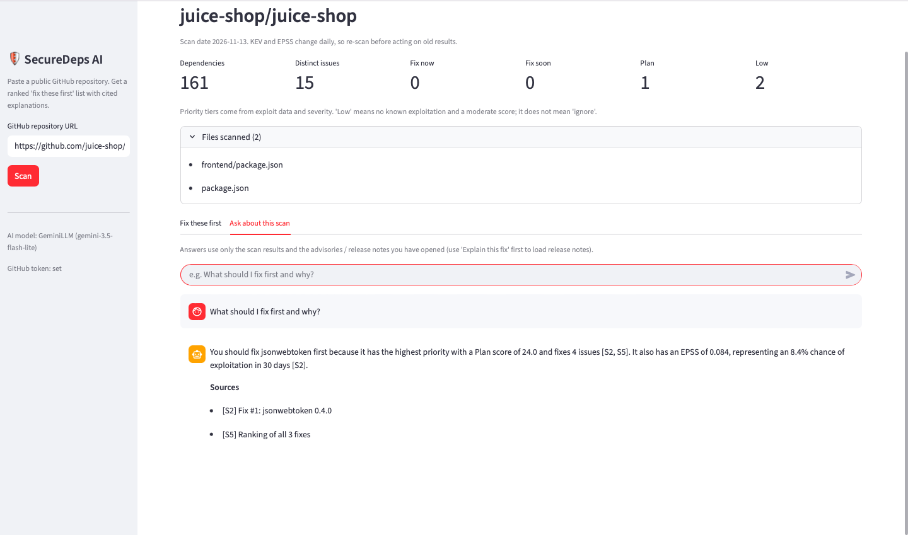

# SecureDeps AI

[](https://github.com/Geetanjali-Kulkarni/securedeps-ai/actions/workflows/tests.yml)

**Which vulnerable dependency should you fix first?**

Paste a public GitHub repository. SecureDeps AI reads its lockfiles, checks every dependency against
public vulnerability data, and ranks the findings by how likely they are to hurt you, not just by how
"severe" they look. An AI layer then explains each fix using the advisories and release notes, with a
source cited for every claim, and code rejects any answer that does not meet that bar.



## The problem

Dependency scanners list hundreds of problems and label many of them "critical". On
[OWASP NodeGoat](https://github.com/OWASP/NodeGoat) (1,091 dependencies, 196 distinct issues) a
severity-only ranking has many issues tied at the same CVSS score, so it cannot say which to fix first.
SecureDeps AI adds two public signals about real-world exploitation:

| Signal | Source | Question it answers |
|---|---|---|
| Vulnerable? | [OSV](https://osv.dev) | Is this exact package version known to be vulnerable? |
| Exploited now? | [CISA KEV](https://www.cisa.gov/known-exploited-vulnerabilities-catalog) | Are attackers using this in real attacks today? |
| Exploited soon? | [EPSS](https://www.first.org/epss/) | How likely is exploitation in the next 30 days? |

## How the ranking works

An explainable score, plain arithmetic on three public numbers:

| Part | Points |
|---|---|
| Listed in CISA KEV | +50 |
| EPSS exploit probability (counts fully at 50% or more) | up to +30 |
| CVSS severity (calculated from the CVSS v3 vector) | up to +20 |
| Development-only dependency | score x 0.5 |

Tiers: **Fix now** (anything in KEV), **Fix soon** (score 35 or more), **Plan** (20 or more), **Low**.
Missing data is never treated as "safe": a vulnerability with no CVE id has KEV status *unknown*, not *no*.

The dashboard shows this ranking next to a severity-only one, so you can see which fixes move and why. The weights are a documented judgement, not a law of nature: change `WEIGHTS` in
`securedeps/ranking.py` and re-run to see how the order moves.

## Architecture

```
GitHub URL
   |
   v
[1 INGEST]   repo.py + parsers.py     find dependency files, parse npm and pip formats,
   |                                  lockfile beats manifest, confidence per dependency
   v
[2 ENRICH]   intel.py + cvss.py       OSV batch query, KEV list, EPSS scores;
   |                                  retries, backoff, parallel record fetch
   v
[3 RANK]     ranking.py               explainable score -> "fix these first" plan
   |
   v
[4 EXPLAIN]  evidence.py, rag.py      advisories + release notes / changelogs -> chunks -> retrieval
   |         llm.py, explain.py       LLM writes prose; code decides risk and validates the text
   v
[5 PRESENT]  scan.py (CLI), app.py (Streamlit dashboard), chat.py, evaluate.py, sample_scan.py
```

`models.py` holds the shared data types and `pipeline.py` wires the stages together; the dashboard
contains no logic of its own.

### Design decisions

- **Deterministic core, AI on top.** Ranking, the upgrade-risk label and the "fix" sentence come from code.
  The LLM only writes the explanation, so the parts that matter are repeatable and testable.
- **Lockfile first.** A lockfile gives exact versions. A range such as `>=2.0` cannot be scanned, so it is
  marked low confidence instead of guessed.
- **A formula, not a trained model.** There is no labelled data to train on, and every number in a formula
  can be explained to the person who has to act on it.
- **No vector database.** A question searches a few dozen chunks, so a list with cosine similarity is enough.
- **Provider interface.** `llm.py` hides Gemini and Anthropic behind one method.
- **Tested without the network.** Every external call is faked in the tests, so 253 tests run offline in
  under a second.

### Guardrails on the AI layer

- Each sentence must cite a retrieved source (`[S3]`); uncited answers get one retry, then are discarded.
- Citations to sources that were not provided are rejected.
- Version numbers in the text that appear in no source are flagged.
- The upgrade-risk label (`unknown`, `no warning keywords found`, `elevated`, `high`) is computed by code,
  and the tool never says an upgrade is "safe": release notes cannot prove that.
- Instructions that the model copies into its answer are stripped.
- If anything fails, the user sees a deterministic explanation built from the same sources.

## Evaluation

Questions are generated from each scan, and the answer key is computed from the deterministic engine (for
example "the top fix is `plan[0].name`"), not from another AI. Every question is also answered with retrieval
only (no LLM) as a baseline. Model: `gemini-3.5-flash-lite` (free tier). Version 1.2.

| Category | OWASP NodeGoat: RAG + LLM | retrieval only | Juice Shop: RAG + LLM | retrieval only |
|---|---|---|---|---|
| Ranking (first, second, third, last, counts, why) | 9/9 | 2/9 | 8/8 | 4/8 |
| Version to upgrade to | 8/8 (by code) | 8/8 (by code) | 3/3 (by code) | 3/3 (by code) |
| Dependency flags | 4/4 | 4/4 | 2/2 | 2/2 |
| Release-note risk | 1/4 | 2/4 | 3/3 | 1/3 |
| Unanswerable (should refuse) | 5/5 | 0/5 | 5/5 | 0/5 |
| **All** | **27/30 (90%)** | **16/30 (53%)** | **21/21 (100%)** | **10/21 (48%)** |

Run it yourself: `python3 -m securedeps.evaluate https://github.com/OWASP/NodeGoat`.

What these numbers do and do not show:

- **Small and author-written.** 51 questions on two repositories, written by the author and graded by an automatic
  check. Juice Shop has only 3 fixes, so it gets fewer questions. Neither repository is held out: bugs found while
  trying both (and three other repositories by hand) were fixed in version 1.2, so these scores are not a clean test.
- The model is slightly random and the vulnerability data changes daily, so expect a few questions to flip.
- **Version questions are answered by code, not by the AI.** "Which version fixes X?" is a lookup of the
  scanner's own result, so both columns are the same.
- **Not all of the passes come from the AI.** On NodeGoat only 14 of 25 answerable AI answers passed the citation
  checks, and on Juice Shop 11 of 16. The rest fell back to plain source passages, which can still pass simple
  questions. The gain over retrieval is clearest on ranking and on refusing unanswerable questions.
- **Weak spot: release-note risk questions.** On NodeGoat the AI scored 1/4 and retrieval alone 2/4, so the AI layer
  does not reliably help here.
- Grading rules were tightened as bugs were found: risk answers must not be refusals and must cite a release-note
  source (a keyword list had marked a correct answer as wrong); version answers must cite a source containing
  the version; "first/second/third/last" answers must name the right package first.

## Quick start

```bash
python3 -m pip install -r requirements.txt
python3 -m pytest -q                                      # 253 tests, no network needed
python3 -m securedeps.scan https://github.com/OWASP/NodeGoat
```

Add AI explanations (optional; without a key the tool shows deterministic explanations):

```bash
export GEMINI_API_KEY="your-key"        # free key from Google AI Studio; never commit it
export GEMINI_MODEL="gemini-3.5-flash-lite"
python3 -m securedeps.scan https://github.com/OWASP/NodeGoat --explain --top=3
```

Dashboard and chat:

```bash
python3 -m pip install -r requirements-ui.txt
streamlit run app.py
```

| Variable | Purpose |
|---|---|
| `GEMINI_API_KEY`, `GEMINI_MODEL` | Gemini explanations (set the model to one your key can use) |
| `ANTHROPIC_API_KEY`, `ANTHROPIC_MODEL` | Use Claude instead; `LLM_PROVIDER=gemini\|anthropic` chooses if both are set |
| `GITHUB_TOKEN` | Optional; raises GitHub's rate limit from 60 to 5,000 requests per hour |
| `SECUREDEPS_DEBUG=1` | Print the raw AI answer when it is rejected |

| Explain a fix | Ask about the scan |
|---|---|
|  |  |

## Project layout

```
app.py                     Streamlit dashboard and chat (display only)
securedeps/
  models.py parsers.py repo.py        reading repositories
  cvss.py intel.py                    OSV, KEV, EPSS, CVSS v3
  ranking.py                          score, tiers, fix plan, severity-only comparison
  evidence.py rag.py                  advisories, release notes, chunking, retrieval
  llm.py explain.py chat.py           providers, grounded explanations, grounded Q&A
  pipeline.py scan.py                 orchestration and CLI
  evaluate.py sample_scan.py          evaluation and sample-scan scripts
tests/                                253 offline tests
```

## Limitations

- Breaking-change detection is keyword-based; a missed warning is possible.
- Projects that only use `pyproject.toml` or `uv.lock` (for example FastAPI) are not scanned yet; the tool says
  so instead of guessing. Java (Maven/Gradle), Go and Rust are not supported either.
- Only npm and PyPI. Transitive dependencies need the parent package updated, or npm `overrides`.
- Version jumps are judged by semantic versioning, so calendar-versioned tools such as Black (25.x to 26.x)
  are flagged as a major jump even when that only means a new year.
- There is no reachability check: a vulnerable package version is flagged even if the affected function (or,
  for some advisories, a separate GitHub Action) is never used by the project.
- The "Low" priority tier means no known exploitation and a moderate score. It does not mean "ignore"; the
  thresholds are a judgement, like the weights.
- KEV and EPSS change daily, so results are a snapshot; the scan date is shown.
- Retrieval uses word-overlap vectors by default. An optional `sentence-transformers` embedder is built in
  (`requirements-ai.txt`) but has not been evaluated.
- Free-tier LLM calls can be slow, rate-limited or overloaded; the tool retries and falls back.
- A single process: no caching across scans and no database.

## Roadmap

`pyproject.toml` / `uv.lock` support, caching across scans, evaluated semantic embeddings, and a published sample scan
of open-source repositories (`python3 -m securedeps.sample_scan` is included; results are not published yet).

## License

MIT. See `LICENSE`.
